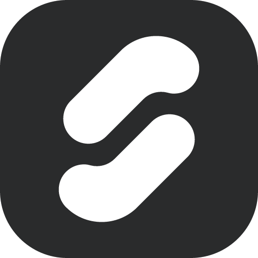
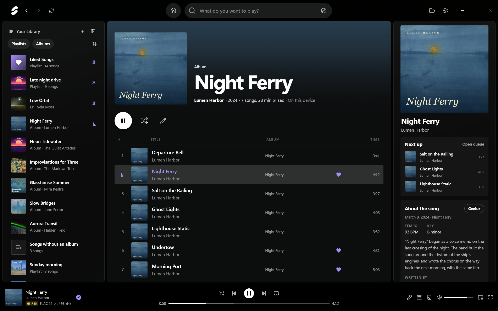
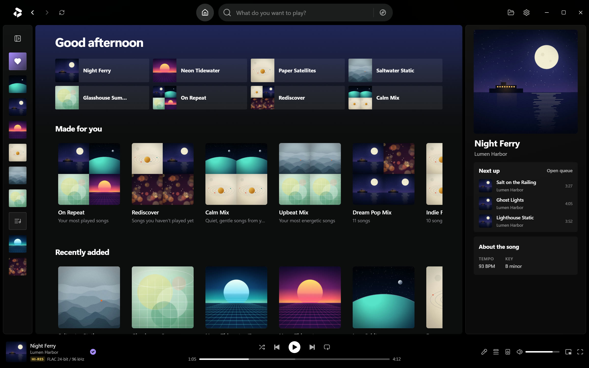
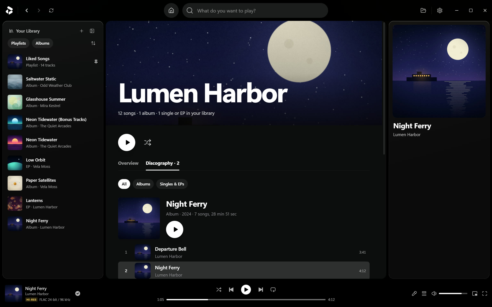
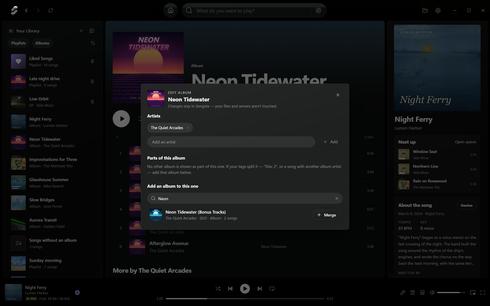
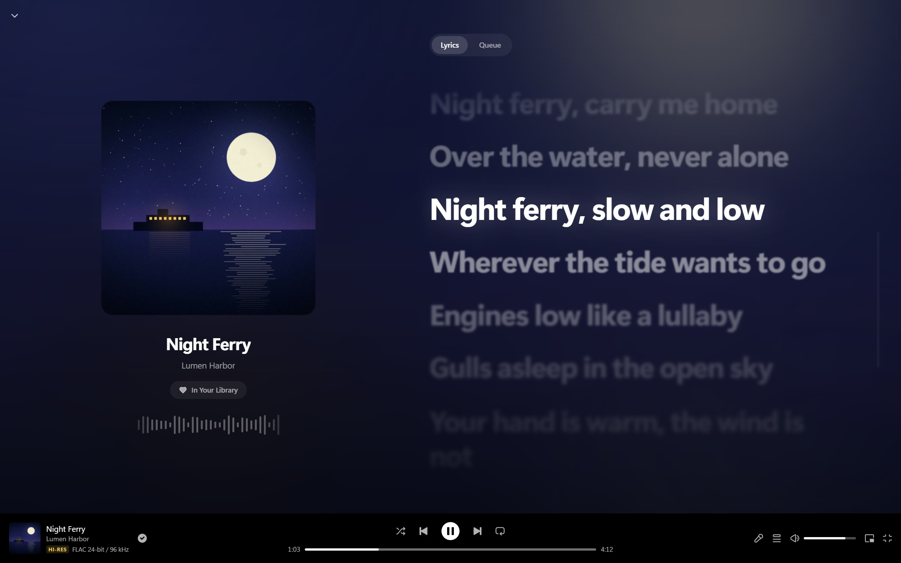
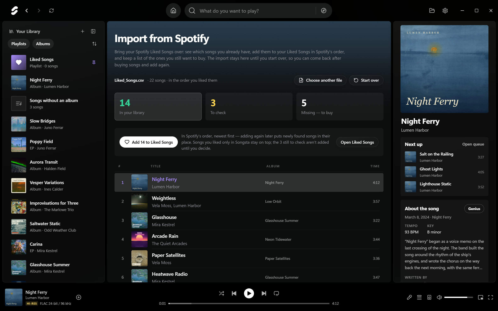

<p align="center">
  
</p>

<h1 align="center">ByTune Local</h1>

<p align="center">
  <b>A local music player for the music you own — Windows and Linux.</b><br>
  Local folders, Jellyfin and Navidrome in one library — Hi-Res playback, synced lyrics and a home page built from your own listening. No account, no ads.
</p>

<p align="center">
  <a href="#install">Install</a> ·
  <a href="#features">Features</a> ·
  <a href="#spotify-import">Spotify import</a> ·
  <a href="#discord-status-optional">Discord</a> ·
  <a href="#build-from-source">Build</a> ·
  <a href="#privacy">Privacy</a> ·
  <a href="#credits-and-license">License</a>
</p>

<p align="center">
  
  <a href="LICENSE"></a>
</p>



ByTune Local is a fork of [ByTune](https://github.com/rishiteja21/ByTune), the open-source YouTube Music desktop app, rebuilt into a player for your own collection. YouTube and the account screens are gone: the app opens in your library, plays from your disk first and streams from your own server only when a file isn't there.

> [!NOTE]
> The screenshots show a **made-up demo library** — artists, songs, covers and lyrics were invented for this page. The app around them is the real build.

## Features

### One library, every source

- **Local folders**, watched while the app runs: new, changed and deleted files show up without a rescan.
- **Jellyfin** (user name and password, or an API key) and **Navidrome or any Subsonic server**. Streams pass through a local proxy, so plain-http servers on your network work too.
- **Duplicates become one song.** A song you have as a local FLAC and on your server is listed once, with its plays added up. It plays from the local file and streams only when that file can't be reached.
- **Unreachable songs are greyed out** — an unplugged drive, a server that doesn't answer — and come back by themselves.
- **Missing facts come from open databases**: covers and album names from MusicBrainz and the Cover Art Archive (iTunes Search as a fallback), artist bios and photos from Wikidata, Wikipedia and Wikimedia Commons. Your files are never rewritten.
- Credits like "Artist A, Artist B" count as two artists, each with their own page.
- **Library check** (Settings): artists written different ways, albums split into parts, songs you have twice, albums without a cover, year or genre, and songs without an album — with a fix wherever ByTune can make one itself.

### Made for good files

- **See what you hear:** the player bar shows *Hi-Res*, *Lossless* or *Lossy* with the codec and the bit depth and sample rate (or bit rate) of what actually plays.
- Plays MP3, AAC, FLAC up to 24-bit/192 kHz, WAV, Ogg Vorbis and Opus directly. AIFF, ALAC, WMA, WavPack, APE and DSD play through [FFmpeg](https://ffmpeg.org/), converted once into a cached 24-bit FLAC with full seeking.
- **Volume leveling** from ReplayGain tags, per song or per album, towards −18, −14 or −11 LUFS. It only ever turns loud songs down.
- **Equalizer:** ten bands, or a parametric EQ with [AutoEQ](https://github.com/jaakkopasanen/AutoEq) corrections for about 9,000 headphones, Equalizer APO import and the frequency response drawn live.
- Crossfade, Automix, skip silence, playback speed, and a volume slider that is actually quiet at the bottom.
- **Sound analysis:** tempo, key and energy of every local song, measured once in the background with FFmpeg. They show in the song's details, Automix times its fades to the beat with them, and they make the *Calm* and *Upbeat* mixes.
- **Seamless albums:** live albums, DJ mixes and songs that run into each other play on without a gap or a crossfade.

### Your music, arranged like a streaming app



- **Home**, built only from your library: quick-access tiles, *Made for you* mixes (On Repeat, Rediscover, what you usually play at this time of day, Calm and Upbeat, one per big genre and decade, reshuffled daily), recently added albums, your top artists and recently played songs.
- **Album and artist pages** with play and shuffle, popular songs ranked by your own plays, the artist's songs you've liked, albums, singles & EPs, "appears on" and the Wikipedia bio.
- **Discography tab:** every release with its songs, newest first.
- **Smart playlists** that fill themselves from rules — genre, artist, year, date added, plays, last played, length, format, sample rate, bit depth, source, liked — with an order and an optional limit.
- **The library panel** puts what you played last on top. Pinned playlists and albums stay above it, in the order you drag them into; the panel folds down to an icon rail (<kbd>Ctrl</kbd>+<kbd>B</kbd>).
- **The right panel** shows the playing song — its title opens the album, its artists their pages — what plays next (drag songs in), the song's story and credits from Genius with its tempo and key, and the artist.



### Fix albums without touching your files



Tags aren't always right. The album editor — the pencil on an album page, or right-click an album in the library panel — lets you

- **add or remove artists** on an album, with one click back to what the tags say, and
- **merge albums** that show up as several (a "Disc 2", bonus tracks, one song with a different album artist), and separate them again.

Songs whose tags name no album gather under **Songs without an album** in the library panel. *Make an album…* puts them on one — title, artist, year and order — or on an album you already have.

ByTune keeps these edits itself; your files and servers stay exactly as they are.

### Lyrics and Now Playing



- **Synced lyrics, your own first:** a `.lrc` next to the file, lyrics embedded in the tags, or your Jellyfin server's. Otherwise online providers such as LRCLIB and KuGou; answers are cached on disk.
- **Search by lyrics:** a line you remember finds the song, among the lyrics already on this computer.
- **Full-screen Now Playing** (<kbd>N</kbd>) with cover, lyrics and queue, tinted by the cover's colors.
- **Mini player:** an always-on-top picture-in-picture window.
- **A real queue:** drag to reorder, *Play next*, *Add to queue*. A song you have in several places still plays only once.
- **Replay:** your listening over time — top artists and songs, hours listened, monthly and hourly patterns.

## Spotify import



Coming from Spotify? Export your Liked Songs with [Exportify](https://github.com/watsonbox/exportify) (CSV) or take `YourLibrary.json` from Spotify's own data download, then open **Import from Spotify** in Liked Songs or Settings. ByTune sorts every song into three lists:

- **In your library** — songs you already have. *Add to Liked Songs* adds them in Spotify's order, newest first. After buying more, add again: new songs land in their place, and songs you liked only in ByTune stay on top.
- **To check** — the title, length or artist spelling differs. Answer *Same song* or *Different*, or *Choose…* the right song from your library yourself. Decided songs leave the list; *Your decisions* can undo them.
- **Missing — to buy** — your shopping list, to save as a spreadsheet or copy.

The import and your decisions are kept until you start over, so they survive restarts.

**Playlists** come over the same way: **+ → Recover a Spotify playlist** in the library panel, or the button in an empty playlist. Use the playlist's CSV from Exportify, or `Playlist1.json` from the data download — it holds all your playlists, and you pick one. The songs you have go into a ByTune playlist in Spotify's order, and your *Same song* / *Different* answers carry over.

## Discord status (optional)

Show what you're listening to on Discord: title, artist and a progress bar, as *Listening to …*. It is off until you switch it on, because Discord wants an application of your own — free, and done in a minute:

1. Open the [Discord Developer Portal](https://discord.com/developers/applications), choose **New Application** and name it, for example *ByTune* — Discord shows this name.
2. Copy the **Application ID** from *General Information*.
3. In ByTune, open **Settings → Discord**, switch on *Discord status* and paste the ID.

The Discord desktop app has to be running; ByTune connects as soon as it starts and clears the status when you pause. Only the Discord app on your computer receives the title and artist — no covers.

## Install

**Windows 10 / 11 (64-bit).** Get `ByTune-Local-Setup.exe` from the [Releases page](https://github.com/steggi-bernd/ByTune/releases) or [build it yourself](#build-from-source). The installer isn't code-signed, so SmartScreen asks once: *More info → Run anyway*.

- It installs as **ByTune Local** (`com.bytune.local`), so it never replaces an installed original ByTune or shares its data.
- Your data lives in `%APPDATA%\ByTune Local`; **Settings → Your data** exports and imports backups.
- For AIFF, ALAC, WMA, WavPack, APE and DSD, install FFmpeg (`winget install ffmpeg`); Settings shows whether it was found.

**Linux (64-bit).** The Releases page has two packages. The **.deb** is for Debian, Ubuntu, Linux Mint, Pop!_OS and their relatives; it puts ByTune in the app menu and installs FFmpeg along with it:

```bash
sudo apt install ./ByTune-Local-amd64.deb
```

The **AppImage** runs on any other distribution — one file, nothing to install:

```bash
chmod +x ByTune-Local-x86_64.AppImage
./ByTune-Local-x86_64.AppImage
```

- AppImages need FUSE 2: `libfuse2t64` on Ubuntu 24.04 and later (`libfuse2` before), `fuse-libs` on Fedora, `fuse2` on Arch. If one stops at start with a message about the "SUID sandbox helper", your system restricts the sandbox Chromium uses (Ubuntu does since 23.10) — take the .deb there, which sets up the AppArmor profile Ubuntu asks for.
- Your data lives in `~/.config/ByTune Local`. Without the .deb, install FFmpeg with your package manager (`sudo apt install ffmpeg`, `sudo pacman -S ffmpeg`, …).
- Server sign-ins are sealed by your desktop's keyring (GNOME Keyring, KWallet). Without one, ByTune keeps them unencrypted in its data folder.
- Media keys and the desktop's media controls work through MPRIS. Under Wayland the mini player can't stay on top of other windows; Wayland doesn't let apps do that.

The Linux packages are built by GitHub Actions for every release; this edition is developed and tested on Windows. The macOS build targets from upstream are still in the project, but untested.

## Build from source

You need [Node.js](https://nodejs.org/) (LTS) and Git.

```bash
git clone https://github.com/steggi-bernd/ByTune.git
cd ByTune
npm install
npm run dev        # Vite + Electron with hot reload
```

```bash
npm test           # unit tests (Node's test runner)
npm run typecheck  # tsc --noEmit
npm run dist:win   # installer: release/ByTune-Local-Setup.exe
npm run dist:linux # on Linux: release/ByTune-Local-x86_64.AppImage and -amd64.deb
```

See [CONTRIBUTING.md](CONTRIBUTING.md) for the project's conventions.

## Keyboard shortcuts

| Action | Keys |
|---|---|
| Play / pause | <kbd>Space</kbd> · media keys |
| Seek ±5 s | <kbd>←</kbd> / <kbd>→</kbd> |
| Previous / next song | <kbd>Shift</kbd>+<kbd>←</kbd> / <kbd>Shift</kbd>+<kbd>→</kbd> |
| Volume · mute | <kbd>↑</kbd> / <kbd>↓</kbd> · <kbd>M</kbd> |
| Shuffle · repeat | <kbd>S</kbd> · <kbd>R</kbd> |
| Queue · lyrics · Now Playing | <kbd>Q</kbd> · <kbd>L</kbd> · <kbd>N</kbd> |
| Search | <kbd>Ctrl</kbd>+<kbd>F</kbd> or <kbd>/</kbd> |
| Fold the library panel | <kbd>Ctrl</kbd>+<kbd>B</kbd> |
| Back / forward | the mouse's back and forward buttons |

Shortcuts never fire while you're typing in a text field.

## Privacy

- **No account, no sign-in, no ads, no analytics.** Your library, likes, playlists and listening history stay on this computer.
- **Passwords aren't stored:** Jellyfin keeps a session token (or your API key), Navidrome a salt/token pair — sealed by Windows (on Linux, your desktop's keyring) through Electron's safeStorage.
- **What goes online:** your own servers; the open-database lookups above, paced to MusicBrainz's one request per second and cached; lyrics providers for songs without lyrics of their own; the AutoEQ index when you search for headphones; and, only if you switch it on, the animated canvas behind the player (a community index and TIDAL's public search).
- **Discord status** talks to the Discord app on your computer, not to the internet.

## Credits and license

ByTune Local is a fork of [ByTune](https://github.com/rishiteja21/ByTune) by [rishiteja21](https://github.com/rishiteja21), which began as a desktop port of the BitChord Android player. Like both, it is licensed under the **GNU GPL v3** — see [LICENSE](LICENSE). Thanks to everyone who built them in the open.

Built with Electron, React, TypeScript, Tailwind CSS, Zustand and music-metadata. ByTune Local is not affiliated with Spotify, Discord, Jellyfin or Navidrome.
